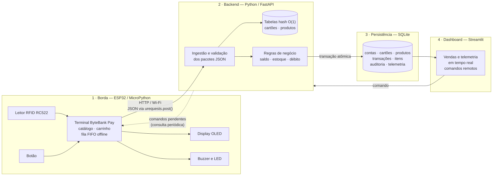
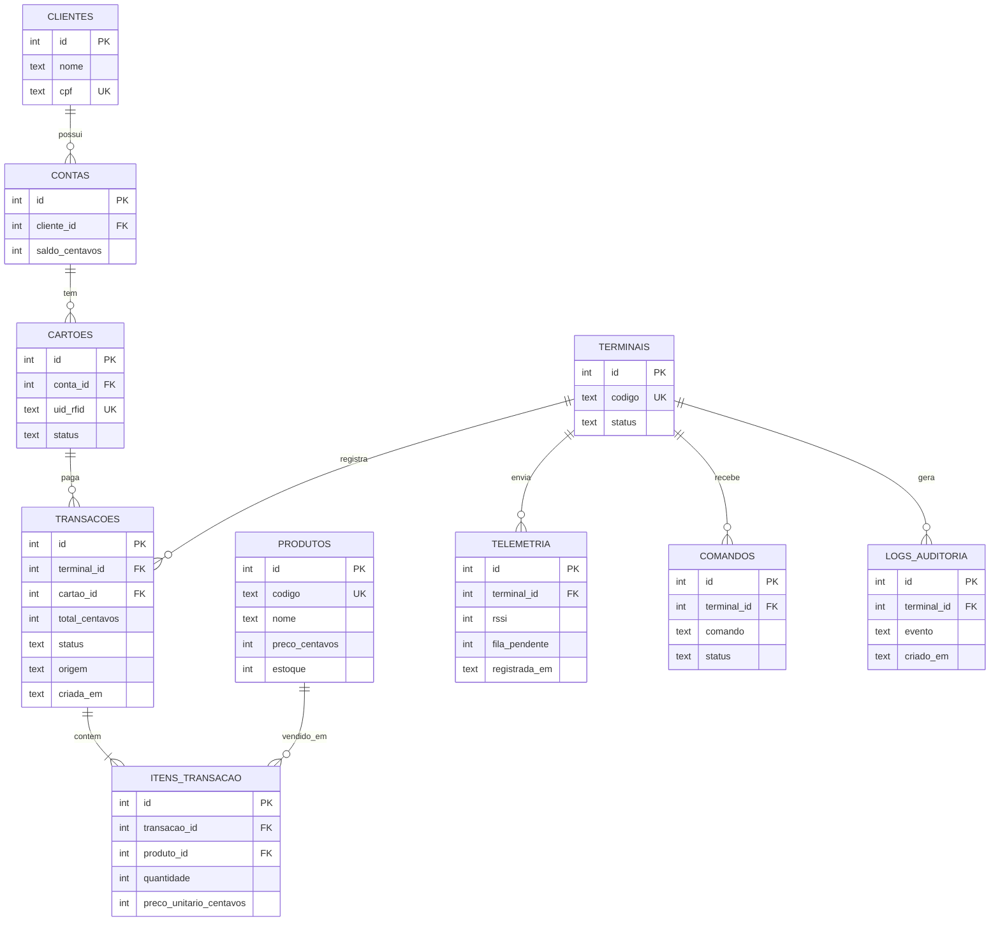
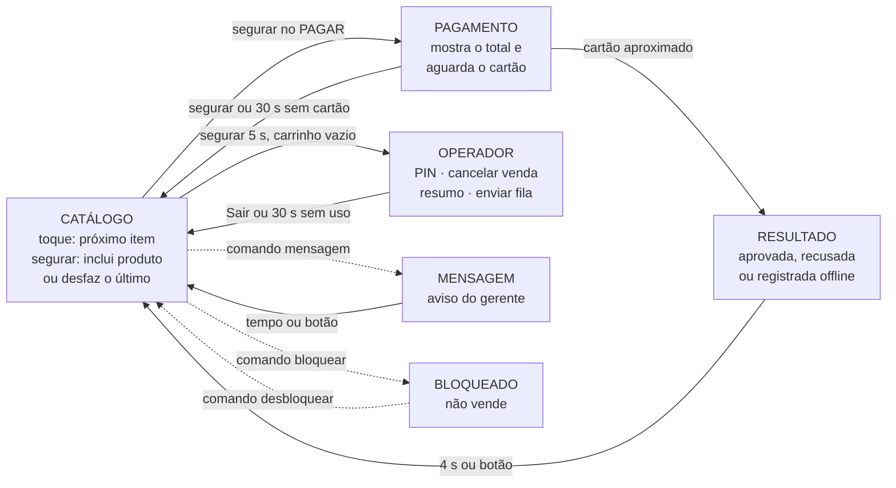
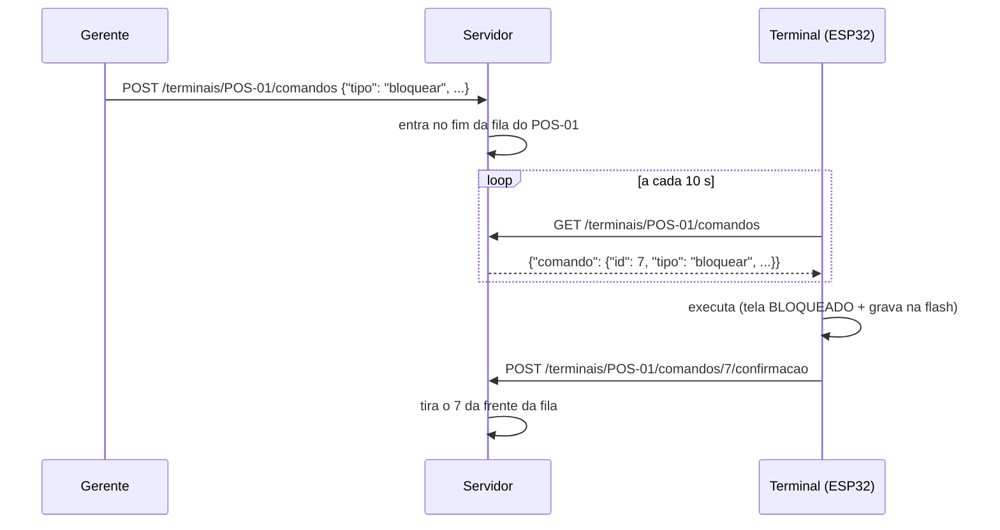

# ByteBank Pay — Terminal POS com Catálogo de Produtos

**Ecossistema ByteBank IoT · Módulo 1: Terminal POS / Maquininha Física**

Projeto Avaliativo AV2 · BD015 – Algoritmo e Estrutura de Dados · CESAR School
**Professor:** Fernando Ferreira de Carvalho

## Equipe

| Integrante |
|---|
| Anna Clara |
| Fabiana Lima |
| Felipe Saraiva |
| Lucas Barros |

---

## Visão geral

O ByteBank Pay é uma maquininha de pagamento construída com um **ESP32** programado
em **MicroPython**. Além de cobrar um valor, ela tem um **catálogo de produtos
próprio**: o cliente escolhe os itens na tela do terminal, monta o carrinho e paga
aproximando o **cartão RFID**.

A cobrança é feita no backend em Python, que localiza o cartão em **O(1)** numa
tabela hash, confere o saldo e o estoque e registra tudo no **banco de dados
relacional**, de forma atômica. Se o Wi-Fi cair, o terminal continua vendendo: as
transações ficam numa **fila FIFO de contingência** e são enviadas quando a
conexão voltar. Um **dashboard em Streamlit** acompanha as vendas em tempo real e
envia comandos de volta para a maquininha.

### Como é uma compra

```
┌────────────────┐     ┌────────────────┐     ┌────────────────┐     ┌────────────────┐
│ 1. Catálogo    │     │ 2. Carrinho    │     │ 3. Pagamento   │     │ 4. Resultado   │
│ >Café    5,00  │ ──▶ │ 3 itens 13,00  │ ──▶ │ Total: 13,00   │ ──▶ │ APROVADA       │
│  Água    3,00  │     │ >PAGAR         │     │ Aproxime o     │     │ Saldo: 987,00  │
│  Suco    7,50  │     │  Desfazer      │     │ cartão...      │     │ (bipe curto)   │
└────────────────┘     └────────────────┘     └────────────────┘     └────────────────┘
 botão: toque desce,    botão: segurar no         leitor RFID            OLED + buzzer
 segurar inclui         PAGAR
```

---

## Arquitetura em 4 camadas



Versão em imagem: [`docs/arquitetura.png`](docs/arquitetura.png).

| Camada | Tecnologia | Responsabilidade |
|---|---|---|
| **Borda** | ESP32 + MicroPython | Ler o botão e o cartão, mostrar catálogo e carrinho, enviar as vendas, guardar vendas offline |
| **Backend** | Python + FastAPI | Validar os pacotes, buscar cartão e produtos em O(1), aplicar as regras e gravar no banco |
| **Persistência** | SQLite | Histórico de transações e itens, saldos, estoque, auditoria e telemetria |
| **Dashboard** | Streamlit | Vendas e estado do terminal em tempo real; comandos como bloquear o terminal ou recarregar o catálogo |

O **FastAPI** gera uma página de testes automática (`/docs`), útil para testar a
API antes de o ESP32 estar pronto. O **SQLite** dispensa servidor de banco e cabe
num único arquivo. As duas escolhas podem ser revistas pela equipe até a Entrega 3.

Os comandos do dashboard chegam ao terminal por **consulta periódica**: o ESP32
pergunta à API, de tempos em tempos, se há comandos para ele. É mais confiável do
que a API tentar abrir uma conexão com a placa, que na rede do laboratório pode
estar inacessível.

### Uma venda, passo a passo


**O backend não confia no preço enviado pela máquina.** O terminal manda apenas
os códigos e as quantidades, e o total é recalculado com os preços do banco. Sem
isso, um terminal adulterado poderia vender qualquer produto por qualquer valor.

---

## Estruturas de dados (AED)

| Onde | Estrutura | Para quê | Complexidade |
|---|---|---|---|
| ESP32 | **Fila FIFO** com índice de início (gravada na flash) | Vendas feitas sem conexão, enviadas na ordem em que aconteceram quando a rede voltar | enfileirar e desenfileirar O(1) |
| ESP32 | **Tabela hash** (dicionário) | Catálogo local: código do produto → produto | busca O(1) |
| ESP32 | **Tabela hash** + **pilha** | Carrinho: quantidade por produto (hash) e ordem das inclusões (pilha), para o `*` desfazer a última | incluir e desfazer O(1) |
| Backend | **Tabela hash** | UID do cartão RFID → conta | busca O(1) |
| ESP32 | Fila de contingência usada como **deque** | O modo operador cancela a última venda tirando-a do **fim** da fila, antes de ser enviada | remover do fim O(1) |
| Backend | **Tabela hash** | Código → produto (preço e estoque) | busca O(1) |
| Backend | **Tabela hash** | `id_transacao` → venda: impede cobrança em dobro e localiza a venda no estorno | busca O(1) |
| Backend | **Fila FIFO** (`deque`) por terminal | Comandos do gerente, executados na ordem em que foram enviados | inserir e retirar O(1) |

### Por que a fila não usa `pop(0)`

`lista.pop(0)` remove o primeiro elemento, mas desloca **todos** os outros uma
posição para a esquerda: custa O(n). A fila de contingência guarda um índice
`_inicio` que aponta para a frente; desenfileirar é só somar 1 a ele, O(1). Os
itens já enviados são descartados de 10 em 10 (compactação), para não ocupar
memória.

```
_itens   [ enviada, enviada, v3, v4, v5 ]
                             ^
                          _inicio  ->  frente da fila = v3
```

### Contingência (sem conexão)

Sem rede, o terminal não consegue consultar o saldo do cliente. Por isso:

- só aceita vendas de até **R$ 50,00** (`LIMITE_OFFLINE_CENTAVOS`), que é o risco
  aceito pelo banco, como nas maquininhas reais;
- guarda no máximo **50 vendas** (`CAPACIDADE`), para não esgotar a memória;
- grava a fila na flash a cada alteração: se a placa desligar, as vendas continuam lá;
- envia as vendas pendentes **uma a cada 5 segundos** quando a conexão volta,
  sempre a mais antiga primeiro;
- se o servidor recusar uma venda na sincronização (por exemplo, por saldo
  insuficiente), ela sai da fila e a recusa é contada na telemetria.

Cada venda tem um **`id_transacao` único**. Se o servidor processar a venda e a
resposta se perder no caminho, o terminal a reenvia pela fila; com o mesmo id, o
servidor reconhece a repetição e **não cobra duas vezes** (idempotência).

---

## Hardware

Componentes confirmados na bancada em 29/10:

| Componente | Função |
|---|---|
| ESP32 com display OLED 0,96" embutido (SSD1306, 128x64) e suporte para bateria 18650 | Microcontrolador com Wi-Fi; mostra catálogo, carrinho e resultado |
| Leitor RFID RC522 (placa HW-126) + cartão e chaveiro de 13,56 MHz | Identificação do cliente |
| Botão de pressão 12x12 mm | Navegar pelo catálogo, escolher produtos e pagar |
| Protoboard e jumpers | Ligações |
| Buzzer e LED (opcionais) | Bipes e luz de aprovação; o código funciona sem eles |

### Mapa de pinos

| Componente | Pino do componente | GPIO do ESP32 |
|---|---|---|
| Display OLED | SDA / SCL | 5 / 4 — já ligado por dentro da placa (o código procura sozinho) |
| RC522 (SPI) | SDA | 27 |
| | SCK | 18 |
| | MOSI | 23 |
| | MISO | 19 |
| | IRQ | não liga |
| | GND | GND |
| | RST | 26 |
| | 3.3V | 3V3 — **nunca em 5 V** |
| Botão | um terminal | 32 (*pull-up* interno: não precisa de resistor) |
| | terminal em diagonal | GND |
| Botão BOOT da placa (alternativa) | — | 0 — sem fio nenhum; basta `PINO_BOTAO = 0` no `config.py` |
| Buzzer (opcional) | + | 17 |
| LED de status do Wi-Fi | — | 16 (usado pelo `boot.py`) |
| LED de aprovação (opcional) | ânodo (via 220 Ω) | 2 |

Cuidados na montagem:

- **As trilhas laterais do protoboard** (linhas azul e vermelha) ligam todos os
  furos da fileira entre si. Elas servem só para distribuir 3V3 e GND. Um
  componente com vários pinos, como o RC522, vai na área central, com **cada pino
  numa coluna numerada diferente**; na trilha, os pinos ficariam em curto.
- O botão de 4 pernas tem as pernas ligadas em pares por dentro. Usando duas
  pernas **em diagonal**, o contato só fecha quando o botão é apertado.
- **Os furos das bordas do ESP32 não têm pinos soldados.** Um jumper só encostado
  no furo perde o contato, e o SPI do leitor precisa de 7 fios firmes ao mesmo
  tempo. O certo é soldar uma barra de pinos (*header*) em cada borda.
- Os pinos foram escolhidos para evitar os *strapping pins* (0, 2, 12 e 15),
  que interferem na inicialização da placa, e os pinos 5 e 4, usados pelo display.

### Diagnóstico da bancada

O `esp32/diagnostico.py` testa cada peça separadamente: procura o display e
escreve nele, conta os toques no botão (curtos e segurados) e lê o leitor RFID,
mostrando a versão do chip e o UID de cada cartão aproximado. Para usar: envie o
`rc522.py` para a placa, abra o `diagnostico.py` no Thonny e clique em
**Executar (▶)**. Os UIDs mostrados vão para a tabela `CARTOES` do servidor.

---

## Modelo de dados (preliminar)

Versão inicial, que será detalhada no `schema.sql` da Entrega 3. Os valores em
dinheiro serão guardados **em centavos** (`INTEGER`), para evitar os erros de
arredondamento de números com casas decimais.



O preço unitário é copiado para `ITENS_TRANSACAO` no momento da venda. Assim, se o
preço do produto mudar depois, o histórico continua mostrando quanto foi cobrado.

---

## Estrutura do repositório

```
bytebank-pay/
├── esp32/                 Camada 1 — código MicroPython
│   ├── boot.py            conexão Wi-Fi na inicialização (Entrega 1)
│   ├── wifi.py            conexão com tempo limite e novas tentativas
│   ├── config_exemplo.py  modelo de configuração (copiar para config.py)
│   ├── main.py            laço principal do terminal (Entrega 2)
│   ├── terminal.py        máquina de estados e telas
│   ├── operador.py        modo operador: PIN, estorno, resumo do caixa
│   ├── comandos.py        comandos remotos do gerente (bloquear, mensagem...)
│   ├── catalogo.py        produtos em tabela hash, com cópia na flash
│   ├── carrinho.py        itens da venda (hash + pilha)
│   ├── fila_offline.py    fila FIFO de contingência
│   ├── pagamentos.py      venda online, contingência e sincronização
│   ├── api.py             comunicação HTTP com urequests
│   ├── hardware.py        display, botão, leitor RFID, buzzer e LED
│   ├── rc522.py           driver do leitor RFID RC522
│   ├── diagnostico.py     teste das peças da bancada (não precisa ficar na placa)
│   ├── arquivos.py        gravação segura de JSON na flash
│   └── formatacao.py      textos para o OLED e valores em reais
├── servidor_teste/        servidor de teste para a Entrega 2 (só biblioteca padrão)
├── ferramentas/           simulador do terminal e enviar_comando.py (papel do gerente)
├── backend/               Camada 2 — API em Python (Entrega 3)
├── database/              Camada 3 — schema.sql e carga de teste (Entrega 3)
├── dashboard/             Camada 4 — Streamlit (Entrega 4)
└── docs/                  diagramas em imagem; fotos e circuito (Entrega 2)
```

---

## Como executar

### ESP32 — conexão Wi-Fi (Entrega 1)

#### 1. Gravar o firmware MicroPython (uma vez por placa)

Baixe o firmware **ESP32_GENERIC** em [micropython.org/download](https://micropython.org/download/ESP32_GENERIC/)
e, no terminal, troque `COM5` pela porta da sua placa:

```bash
pip install esptool
esptool --chip esp32 --port COM5 erase_flash
esptool --chip esp32 --port COM5 --baud 115200 write_flash -z --flash_mode dio 0x1000 firmware.bin
```

O `--flash_mode dio` evita que a placa fique reiniciando em loop depois da gravação.

#### 2. Preparar a configuração

Copie `esp32/config_exemplo.py` para `esp32/config.py` e preencha `WIFI_SSID` e
`WIFI_SENHA` (a partir da Entrega 2, também `API_URL` e `PIN_OPERADOR`). O ESP32 só conecta em redes de **2,4 GHz**. O `config.py` não vai
para o GitHub (está no `.gitignore`).

#### 3. Enviar para a placa — opção A: Thonny (usada pela equipe)

**Conectar**

1. Ligue o ESP32 na USB.
2. No canto inferior direito do Thonny, troque o interpretador para
   **MicroPython (ESP32)** e escolha a porta da placa. Se a porta não aparecer,
   use *Ferramentas > Opções > Intérprete*.
3. O **Shell**, na parte de baixo, deve mostrar o prompt `>>>`.

**Enviar os arquivos**

1. Ative a visão de arquivos em **Exibir > Arquivos**. Aparecem dois painéis:
   *Este computador*, em cima, e *Dispositivo MicroPython*, embaixo.
2. No painel do computador, abra a pasta `esp32` do repositório.
3. Selecione `wifi.py`, `config.py` e `boot.py`, clique com o botão direito e
   escolha **Enviar para /** (*Upload to /*).
4. Confira se os três aparecem no painel **Dispositivo MicroPython**.

Também funciona abrir cada arquivo e usar *Arquivo > Salvar como >
Dispositivo MicroPython*, com o mesmo nome, como no guia do professor.

**Ver o boot rodando**

O `boot.py` só roda quando a placa **reinicia**. Com a placa conectada ao Thonny:

- clique no **Shell** e pressione **`Ctrl+D`** (reinício suave). A placa roda o
  `boot.py` e as mensagens aparecem no Shell.

Evite o botão **EN** da placa com o Thonny aberto: ele reinicia também a
conexão USB, e as primeiras mensagens costumam se perder. Se o Thonny mostrar
*"Connection lost"* ou *"Device is busy"*, clique no botão vermelho **Parar**
(*Stop/Restart backend*).

**Cuidados**

- O botão **Executar (▶)** roda o arquivo aberto **sem salvá-lo na placa**. Serve
  para testar, mas o `boot.py` precisa estar salvo no dispositivo para rodar
  sozinho quando a placa ligar.
- O `boot.py` importa o `wifi.py`: se o `wifi.py` não estiver na placa, aparece
  `ImportError: no module named 'wifi'`.
- Depois de alterar um arquivo no computador, **envie de novo**: o Thonny não
  sincroniza sozinho.
- Se o Shell parar de responder, clique no Shell e pressione `Ctrl+C`.

#### 3. Enviar para a placa — opção B: VS Code + MicroPico

1. Instale a extensão **MicroPico** (`Ctrl+Shift+X`).
2. Abra a **pasta raiz do repositório** (`Arquivo > Abrir Pasta`).
3. `Ctrl+Shift+P` → **MicroPico: Configure Project**.
4. **Importante:** em `.vscode/settings.json`, acrescente:

   ```json
   "micropico.syncFolder": "esp32"
   ```

   Sem isso, o MicroPico envia **o repositório inteiro** para o ESP32, incluindo o
   backend, o dashboard e as imagens, e ocupa a memória da placa à toa. Com essa
   linha, só o conteúdo de `esp32/` vai para a raiz da placa.
5. Conecte o ESP32 na USB e clique em **Pico/ESP32 Connect**, na barra inferior.
6. `Ctrl+Shift+P` → **MicroPico: Upload project to board**.
7. Abra o console em **MicroPico: Toggle Execution Terminal / REPL** e reinicie a
   placa (botão **EN**).

#### 3. Enviar para a placa — opção C: linha de comando

```bash
pip install mpremote
mpremote cp esp32/boot.py esp32/wifi.py esp32/config.py :
mpremote reset
mpremote repl
```

**Saída esperada:**

```
========================================
  ByteBank Pay - Terminal POS
========================================
[Wi-Fi] Tentativa 1/3: conectando a 'NOME_DA_REDE'...
[Wi-Fi] Conectado. IP: 192.168.0.42
[BOOT] Rede: IP 192.168.0.42 | gateway 192.168.0.1 | sinal -61 dBm
[BOOT] Relógio sincronizado: 29/10/2026 14:05
[BOOT] Memória livre: 118560 bytes
[BOOT] Inicialização concluída.
```

O LED de status (GPIO 16) **pisca** enquanto conecta e fica **aceso** quando a conexão
dá certo.

| Mensagem | Causa provável |
|---|---|
| `Senha incorreta` | `WIFI_SENHA` errada no `config.py` |
| `Falhou: rede não encontrada` | nome da rede errado, rede de 5 GHz ou placa longe do roteador |
| `config.py não encontrado` | o arquivo não foi enviado para a placa |
| `Iniciando em MODO OFFLINE` | nenhuma das 3 tentativas funcionou; a placa segue funcionando sem rede |
| A placa reinicia sem parar, com mensagens ilegíveis | firmware gravado sem `--flash_mode dio`; grave de novo (passo 1) |
| A porta da placa não aparece | cabo USB só de carga ou driver do conversor USB (CP210x ou CH340) não instalado |

O `boot.py` **nunca trava a placa**: toda espera tem tempo limite e, sem rede, o
terminal segue em modo offline.

---

### Terminal completo (Entrega 2)

#### Arquivos que vão para a placa

Todos os `.py` da pasta `esp32/`, **menos** o `config_exemplo.py` (no lugar dele vai
o seu `config.py`) e o `diagnostico.py` (que só é executado pelo Thonny). O driver
do leitor RFID (`rc522.py`) já está no repositório; o do display se instala uma vez:

| Driver | Componente | Como instalar |
|---|---|---|
| `ssd1306.py` | display OLED | com a placa no Wi-Fi, no Shell do Thonny: `import mip; mip.install("ssd1306")` |
| `rc522.py` | leitor RFID RC522 | vem na pasta `esp32/`; envie junto com os outros |

Tudo o que depende do hardware está em `esp32/hardware.py`: se um componente ou
pino mudar, só esse arquivo precisa de ajuste.

Se um driver estiver faltando ou um componente não responder, o terminal **não
trava**: avisa no Shell e continua funcionando sem aquele componente. O conteúdo
do display também aparece no Shell do Thonny, o que permite usar o terminal mesmo
sem o OLED ligado.

#### Como usar o terminal

Tudo é feito com **um botão**, pelo tempo que ele fica apertado:

| Gesto | No catálogo | No pagamento | No resultado / aviso |
|---|---|---|---|
| **Toque** (rápido) | desce o cursor `>` para o próximo item | — | volta ao catálogo |
| **Segurar** (~1 s, até o bipe, e soltar) | escolhe o item do cursor: inclui o produto, vai para o **PAGAR** ou **Desfaz** a última inclusão | volta ao catálogo | volta ao catálogo |
| **Segurar 5 s** | carrinho vazio: modo operador; com itens: esvazia o carrinho | — | — |
| Aproximar o cartão | — | paga | — |

```
PRODUTOS     1/2        Com algo no carrinho, a lista ganha
>Cafe       5,00        no fim as opções "PAGAR R$ ..." e
 Agua       3,00        "Desfazer ultimo". A última linha
 Suco       7,50        lembra o que o botão faz no item
 Pao de que 4,50        do cursor.
 Bolo       6,00
2 itens  R$ 8,00
Toque:> Segure:+
```



Se o pagamento for **recusado**, o carrinho é mantido para o cliente tentar outro
cartão. Quando o terminal está sem conexão, aparece `OFF` no canto da tela.

#### Produto esgotado

O catálogo vem do servidor com o **estoque** de cada produto. Com estoque zero, o
preço dá lugar a `esgot` na tela e escolher o produto avisa `Esgotado`. Também não
dá para pôr no carrinho mais unidades do que há (`So 2 em estoque`).

O estoque do terminal é só uma cópia: ele desconta o que vende e é atualizado pelo
servidor a cada 5 minutos (com o terminal parado) ou quando o gerente manda
`atualizar_catalogo`. **Quem decide é o servidor**, que confere o estoque de novo
em cada venda; se a cópia estiver desatualizada, a venda é recusada com
`Sem estoque de ...`.

#### Modo operador

Um menu escondido, protegido por PIN, para quem cuida do caixa:

1. com o carrinho **vazio**, **segure o botão por 5 s**;
2. digite o PIN: o dígito da vez aparece na tela; cada **toque** soma 1
   (0, 1, 2 ... 9) e **segurar** confirma o dígito. Os já confirmados aparecem
   como `*`, e o PIN é conferido sozinho depois do último dígito;
3. no menu, **toque** desce e **segurar** escolhe:

| Opção | O que faz |
|---|---|
| Cancelar venda | Estorna a **última** venda deste terminal, depois de confirmar (segurar = sim, toque = não). Se ela ainda está na fila offline, só sai da fila (o servidor nunca soube dela). Se já foi enviada, o servidor devolve o dinheiro ao cliente e o estoque (`POST /estornos`). |
| Resumo caixa | Vendas e cancelamentos deste terminal, pelo servidor, e vendas na fila offline |
| Enviar fila | Envia na hora todas as vendas pendentes da fila offline |
| Sair | Volta ao catálogo (segurar 5 s também sai, de qualquer tela) |

O PIN fica em `PIN_OPERADOR`, no `config.py`, que não vai para o GitHub. Sem PIN
no `config.py`, o modo operador fica desligado. Depois de **3 PINs errados**, o
modo trava por 60 s, e o terminal volta sozinho ao catálogo após **30 s sem
uso**. O estorno também é idempotente: repetido, não devolve o dinheiro duas
vezes.

#### Comandos remotos (prepara a Entrega 4)

O gerente coloca comandos numa **fila FIFO** do servidor, uma por terminal. O
ESP32 pergunta a cada 10 s se há algo para ele (só quando ninguém está comprando
nem digitando), executa e confirma. O comando só sai da fila depois de
confirmado.

| Comando | Efeito no terminal |
|---|---|
| `atualizar_catalogo` | busca preços e estoque de novo |
| `mensagem` | mostra um aviso por alguns segundos (3 a 60) |
| `bloquear` | trava o terminal com um motivo na tela; o bloqueio é gravado na flash e continua depois de reiniciar. O servidor passa a recusar vendas novas desse terminal na hora. |
| `desbloquear` | volta a vender |



Até o dashboard existir, a ferramenta `ferramentas/enviar_comando.py` faz o papel
do gerente:

```bash
python ferramentas/enviar_comando.py mensagem "Promocao: cafe a R$ 4,00" --segundos 15
python ferramentas/enviar_comando.py bloquear "Manutencao. Use o caixa 2"
python ferramentas/enviar_comando.py desbloquear
python ferramentas/enviar_comando.py preco 1 400      # muda o preço e atualiza o terminal
python ferramentas/enviar_comando.py estoque 7 0      # zera o estoque: aparece "esgot"
```

Use `--terminal` para outro terminal (padrão `POS-01`) e `--url` se o servidor
não estiver no mesmo computador.

#### Servidor de teste

A Entrega 2 pede o envio de JSON para um servidor de teste. O
`servidor_teste/servidor.py` usa só a biblioteca padrão do Python, então não é
preciso instalar nada:

```bash
python servidor_teste/servidor.py
```

Ele mostra o `API_URL` que deve ir no `config.py` do ESP32. **O computador e a
placa precisam estar na mesma rede**, e o Windows pode pedir para liberar o Python
no firewall: aceite para redes privadas.

| Rota | Quem usa | Para quê |
|---|---|---|
| `GET /produtos` | terminal | catálogo com preço e estoque |
| `POST /transacoes` | terminal | venda |
| `POST /estornos` | terminal (modo operador) | cancela uma venda aprovada |
| `GET /terminais/<id>/resumo` | terminal (modo operador) | resumo do caixa |
| `GET /terminais/<id>/comandos` | terminal | próximo comando pendente |
| `POST /terminais/<id>/comandos/<n>/confirmacao` | terminal | comando executado |
| `POST /telemetria` | terminal | estado da placa a cada 60 s |
| `POST /terminais/<id>/comandos` | gerente | coloca um comando na fila |
| `PATCH /produtos/<codigo>` | gerente | muda preço ou estoque |

Os cartões de teste ficam na tabela `CARTOES` do servidor. Quando um cartão
desconhecido é lido, o servidor mostra o UID dele no console: basta copiar para a
tabela. Os dados ficam em memória e somem ao fechar o servidor. O backend definitivo
é o da Entrega 3.

#### Simulador (sem a placa)

Para testar o fluxo de venda no computador, com os **mesmos arquivos** da pasta
`esp32/`, com o servidor de teste rodando em outro terminal:

```bash
python ferramentas/simulador.py
```

O botão vira caracteres: `.` é um toque, `-` é segurar e `!` é segurar 5 s
(`.-` = desce e escolhe). Aproxime um cartão com `c A1B2C3D4` e simule a queda
do Wi-Fi com `off` e a volta com `on`. Para testar mais rápido há atalhos de
teclado numérico: `112#` inclui dois Cafés e uma Água e vai para o pagamento, e
`***2580#` abre o modo operador (o PIN do simulador é `2580`). Os comandos do `enviar_comando.py` são aplicados depois de
cada linha digitada. A lista completa está no início do arquivo.

#### Pacote JSON de uma venda

Enviado pelo terminal em `POST /transacoes`:

```json
{
  "id_transacao": "POS-01-3f9a1c7b2e40",
  "terminal": "POS-01",
  "uid_cartao": "A1B2C3D4",
  "itens": [{"codigo": "1", "quantidade": 2}, {"codigo": "2", "quantidade": 1}],
  "total_centavos": 1300,
  "criada_em": "2026-11-05T14:03:10Z",
  "relogio_sincronizado": true,
  "origem": "online"
}
```

O `total_centavos` é só informativo: **o servidor recalcula o total** com os preços
dele. `origem` é `"contingencia"` para vendas que passaram pela fila offline.

Resposta aprovada (HTTP 200):

```json
{"status": "aprovada", "transacao_id": 17, "total_centavos": 1300, "saldo_centavos": 98700}
```

Resposta recusada (HTTP 4xx):

```json
{"status": "recusada", "motivo": "Saldo insuficiente"}
```

Sem resposta, ou com erro do servidor (HTTP 5xx), a venda vai para a fila de contingência.

#### Tratamento de falhas

| Situação | O que o terminal faz |
|---|---|
| Wi-Fi cai | indica `OFF`, vende em contingência e tenta reconectar a cada 30 s, só quando ninguém está usando |
| Servidor desligado ou lento (mais de 5 s) | trata como sem conexão: contingência |
| Servidor com erro interno (HTTP 5xx) | contingência; a venda não foi cobrada |
| Resposta perdida depois de o servidor cobrar | reenvio pela fila com o mesmo `id_transacao`; o servidor não cobra de novo |
| Placa desliga com vendas pendentes | a fila está gravada na flash e é recuperada ao ligar |
| Arquivo da fila corrompido | guarda como `.corrompido`, para análise, e recomeça vazia |
| Catálogo indisponível no servidor | usa a cópia da flash; sem ela, o catálogo padrão |
| Driver do display ou do RFID ausente | avisa no Shell e segue sem o componente |
| Fio solto no OLED ou no RFID durante o uso | avisa no Shell, não trava |
| Mesmo cartão encostado por vários segundos | lido uma vez só (3 s de intervalo) |
| Trepidação do botão (*bouncing*) | só aceita a mudança depois de 30 ms estável |
| Toques rápidos durante um bipe | os bipes não param o laço principal, então nenhum toque se perde |
| Leitor RFID com fio solto ou sem 3V3 | versão do chip lida como 0x00/0xFF: avisa no Shell e desativa o leitor |
| Servidor não responde à consulta de comandos | passa a perguntar a cada 60 s em vez de 10 s |
| Confirmação de comando perdida | o comando chega de novo; todos podem ser repetidos sem estrago |
| Placa reinicia bloqueada | o bloqueio está gravado na flash e continua valendo |
| PIN do operador errado 3 vezes | modo operador travado por 60 s |
| Estoque da cópia local desatualizado | o servidor confere de novo e recusa com `Sem estoque de ...` |
| Erro inesperado | mostra a linha do erro e reinicia a placa em 10 s (Ctrl+C cancela) |

---

## Cronograma de entregas

| Data | Entrega | Conteúdo | Peso |
|---|---|---|---|
| 29/10 | **1 · Setup e arquitetura** | Repositório, README inicial, diagrama de arquitetura, `boot.py` conectando ao Wi-Fi | 10% |
| 05/11 | 2 · MicroPython e AED na placa | `main.py` com sensores e atuadores, fila offline, envio de JSON, foto do circuito | 20% |
| 12/11 | 3 · Backend e banco | API recebendo e validando, `schema.sql`, tabelas hash e transações atômicas | 20% |
| 19/11 | 4 · Dashboard e integração | Streamlit em tempo real, comandos para o ESP32, teste ponta a ponta | 20% |
| 26/11 | Final | Apresentação e defesa técnica na bancada | 30% |

### Entrega 1 — checklist

- [x] Repositório público criado
- [x] README inicial
- [x] Diagrama de arquitetura em blocos
- [x] `boot.py` conectando ao Wi-Fi na bancada

### Entrega 2 — checklist

- [x] `main.py` com botão, leitor RFID, display, buzzer e LED (testado no simulador)
- [x] Componentes identificados na bancada (29/10) e `diagnostico.py` para testar cada peça
- [x] Estruturas de dados na placa: fila FIFO de contingência, tabelas hash, pilha do carrinho
- [x] Servidor de teste recebendo o JSON enviado com `urequests`
- [x] Pedido do professor: catálogo de produtos no próprio terminal
- [x] Extras: produto esgotado, modo operador (estorno, resumo, fila) e comandos remotos (testados no simulador)
- [ ] Rodar o `diagnostico.py` com tudo ligado (display, botão e leitor) e cadastrar os UIDs no servidor
- [ ] Testar na bancada: venda online, queda de rede e sincronização
- [ ] Foto ou GIF do circuito montado em `docs/` e no README

---

## Tecnologias

MicroPython · ESP32 · esptool · VS Code + MicroPico · Thonny · Python 3 · FastAPI · SQLite · Streamlit · Git/GitHub
