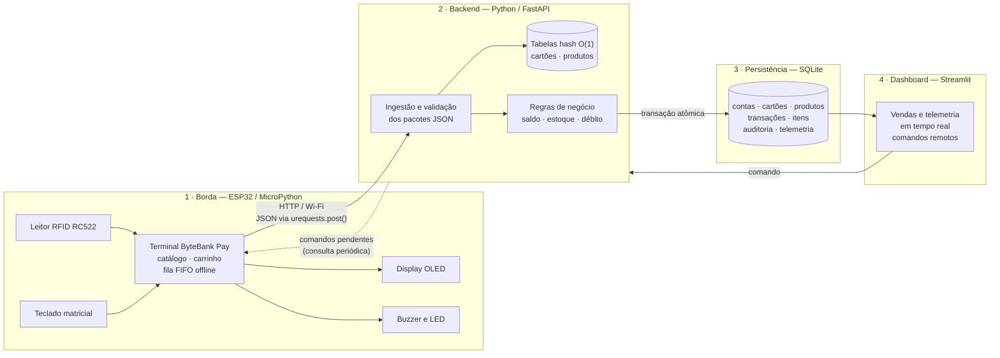
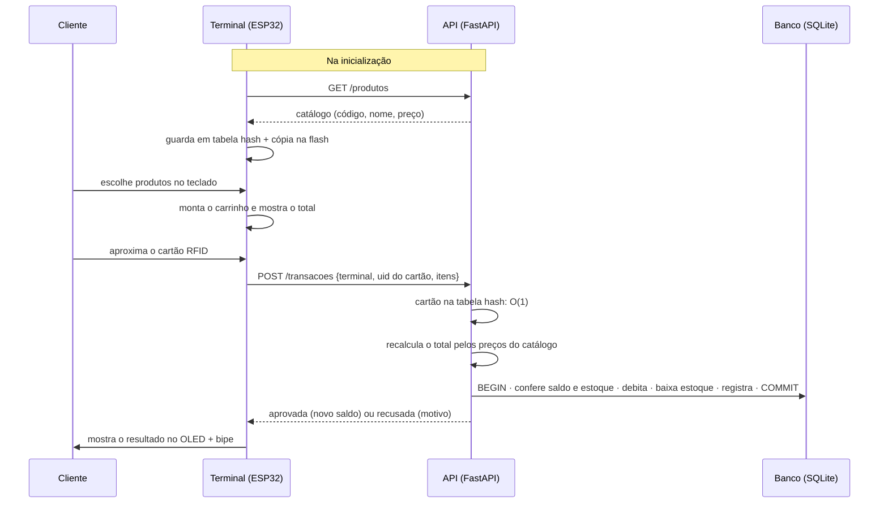
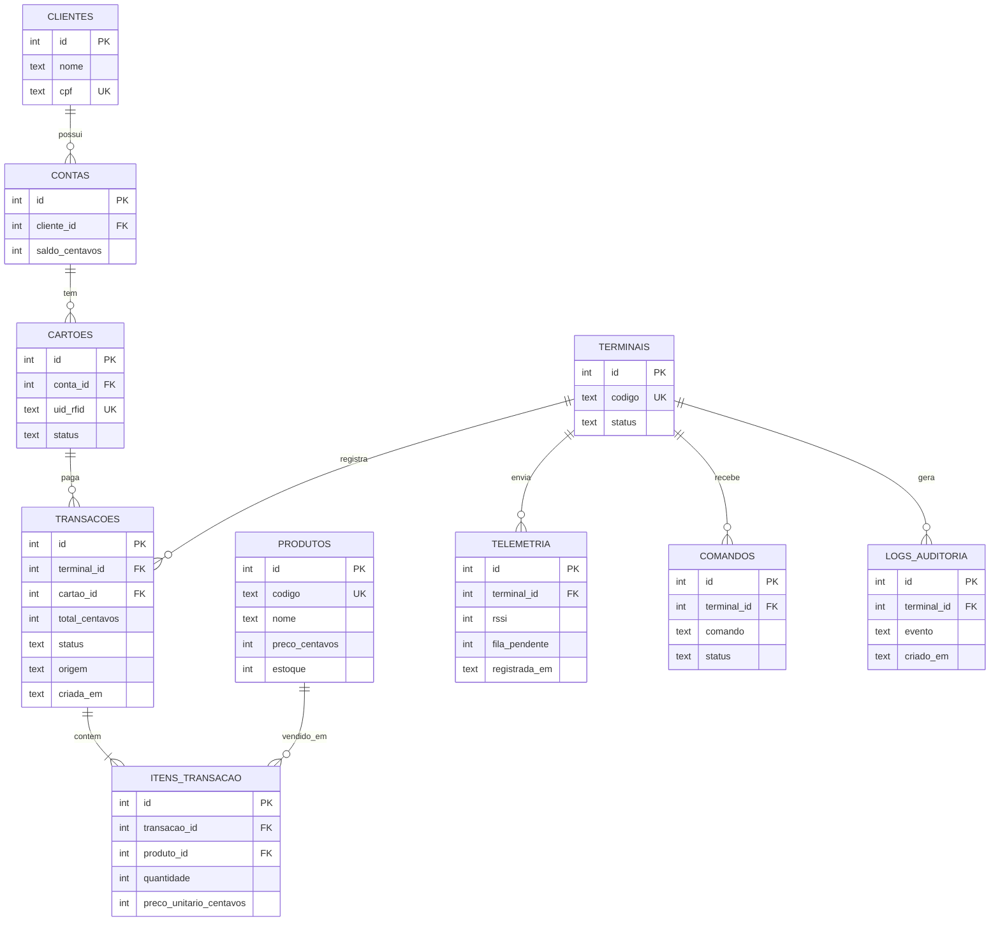

# ByteBank Pay — Terminal POS com Catálogo de Produtos

**Ecossistema ByteBank IoT · Módulo 1: Terminal POS / Maquininha Física**

Projeto Avaliativo AV2 · BD015 – Algoritmo e Estrutura de Dados · CESAR School
**Professor:** Fernando Ferreira de Carvalho

## Equipe

| Integrante |
|---|
| Anna Clara |
| Fabiana Lima |
| Felipe Saraiva |
| Lucas Barros |

---

## Visão geral

O ByteBank Pay é uma maquininha de pagamento construída com um **ESP32** programado
em **MicroPython**. Além de cobrar um valor, ela tem um **catálogo de produtos
próprio**: o cliente escolhe os itens na tela do terminal, monta o carrinho e paga
aproximando o **cartão RFID**.

A cobrança é feita no backend em Python, que localiza o cartão em **O(1)** numa
tabela hash, confere o saldo e o estoque e registra tudo no **banco de dados
relacional**, de forma atômica. Se o Wi-Fi cair, o terminal continua vendendo: as
transações ficam numa **fila FIFO de contingência** e são enviadas quando a
conexão voltar. Um **dashboard em Streamlit** acompanha as vendas em tempo real e
envia comandos de volta para a maquininha.

### Como é uma compra

```
┌────────────────┐     ┌────────────────┐     ┌────────────────┐     ┌────────────────┐
│ 1. Catálogo    │     │ 2. Carrinho    │     │ 3. Pagamento   │     │ 4. Resultado   │
│ 1 Café   5,00  │ ──▶ │ 2x Café  10,00 │ ──▶ │ Total: 13,00   │ ──▶ │ APROVADO ✓     │
│ 2 Água   3,00  │     │ 1x Água   3,00 │     │ Aproxime o     │     │ Saldo: 987,00  │
│ 3 Suco   7,50  │     │ #=pagar *=limpa│     │ cartão...      │     │ (bipe curto)   │
└────────────────┘     └────────────────┘     └────────────────┘     └────────────────┘
   teclado: código        teclado: # / *        leitor RFID            OLED + buzzer
```

---

## Arquitetura em 4 camadas



Versão em imagem: [`docs/arquitetura.png`](docs/arquitetura.png).

| Camada | Tecnologia | Responsabilidade |
|---|---|---|
| **Borda** | ESP32 + MicroPython | Ler o teclado e o cartão, mostrar catálogo e carrinho, enviar as vendas, guardar vendas offline |
| **Backend** | Python + FastAPI | Validar os pacotes, buscar cartão e produtos em O(1), aplicar as regras e gravar no banco |
| **Persistência** | SQLite | Histórico de transações e itens, saldos, estoque, auditoria e telemetria |
| **Dashboard** | Streamlit | Vendas e estado do terminal em tempo real; comandos como bloquear o terminal ou recarregar o catálogo |

O **FastAPI** gera uma página de testes automática (`/docs`), útil para testar a
API antes de o ESP32 estar pronto. O **SQLite** dispensa servidor de banco e cabe
num único arquivo. As duas escolhas podem ser revistas pela equipe até a Entrega 3.

Os comandos do dashboard chegam ao terminal por **consulta periódica**: o ESP32
pergunta à API, de tempos em tempos, se há comandos para ele. É mais confiável do
que a API tentar abrir uma conexão com a placa, que na rede do laboratório pode
estar inacessível.

### Uma venda, passo a passo



**O backend não confia no preço enviado pela máquina.** O terminal manda apenas
os códigos e as quantidades, e o total é recalculado com os preços do banco. Sem
isso, um terminal adulterado poderia vender qualquer produto por qualquer valor.

---

## Estruturas de dados (AED)

| Onde | Estrutura | Para quê | Complexidade |
|---|---|---|---|
| ESP32 | **Fila FIFO** (gravada na flash) | Vendas feitas sem Wi-Fi, enviadas na ordem em que aconteceram quando a rede voltar | enfileirar O(1) |
| ESP32 | **Tabela hash** (dicionário) | Catálogo local: código digitado → produto | busca O(1) |
| ESP32 | Lista | Itens do carrinho da venda em andamento | — |
| Backend | **Tabela hash** | UID do cartão RFID → conta | busca O(1) |
| Backend | **Tabela hash** | Código → produto (preço e estoque) | busca O(1) |

Em contingência (sem rede), o terminal não consegue consultar o saldo. Por isso,
vendas offline terão um **valor máximo por operação**, e o backend pode recusá-las
na sincronização (por exemplo, por saldo insuficiente). A recusa fica registrada
na auditoria. Essa regra será detalhada na Entrega 2.

---

## Hardware

| Componente | Função |
|---|---|
| ESP32 DevKit (38 pinos) | Microcontrolador com Wi-Fi |
| Leitor RFID RC522 + cartões/tags | Identificação do cartão do cliente |
| Display OLED SSD1306 0,96" (I2C) | Catálogo, carrinho e resultado |
| Teclado matricial 4x3 | Escolher produtos (0–9), limpar (`*`) e pagar (`#`) |
| Buzzer ativo | Bipe de aprovação e de recusa |
| LED verde + resistor 220 Ω | Venda aprovada |

### Mapa de pinos (proposta — confirmar com os componentes da bancada)

| Componente | Pino do componente | GPIO do ESP32 |
|---|---|---|
| RC522 (SPI) | SDA (SS) | 5 |
| | SCK | 18 |
| | MOSI | 23 |
| | MISO | 19 |
| | RST | 4 |
| | 3.3V | 3V3 — **nunca em 5 V** |
| OLED (I2C) | SDA | 21 |
| | SCL | 22 |
| | VCC | 3V3 |
| Teclado 4x3 | Linhas L1–L4 | 13, 14, 27, 26 |
| | Colunas C1–C3 | 25, 33, 32 |
| Buzzer | + | 17 |
| LED verde | ânodo (via 220 Ω) | 16 |
| LED da placa | — | 2 (status do Wi-Fi, usado pelo `boot.py`) |

Os pinos foram escolhidos para evitar os *strapping pins* (0, 2, 12 e 15), que
interferem na inicialização da placa quando estão ligados a algum componente. A
exceção é o GPIO 2, usado só pelo LED que já vem na placa. Se o teclado for 4x4, a
quarta coluna pode ir no GPIO 35 com um resistor de *pull-up* externo de 10 kΩ,
porque os GPIOs 34–39 não têm *pull-up* interno.

---

## Modelo de dados (preliminar)

Versão inicial, que será detalhada no `schema.sql` da Entrega 3. Os valores em
dinheiro serão guardados **em centavos** (`INTEGER`), para evitar os erros de
arredondamento de números com casas decimais.



O preço unitário é copiado para `ITENS_TRANSACAO` no momento da venda. Assim, se o
preço do produto mudar depois, o histórico continua mostrando quanto foi cobrado.

---

## Estrutura do repositório

```
bytebank-pay/
├── esp32/                 Camada 1 — código MicroPython
│   ├── boot.py            conexão Wi-Fi na inicialização (Entrega 1)
│   ├── wifi.py            conexão com tempo limite e novas tentativas
│   ├── config_exemplo.py  modelo de configuração (copiar para config.py)
│   └── main.py            leitura de sensores e vendas (Entrega 2)
├── backend/               Camada 2 — API em Python (Entrega 3)
├── database/              Camada 3 — schema.sql e carga de teste (Entrega 3)
├── dashboard/             Camada 4 — Streamlit (Entrega 4)
└── docs/                  diagramas em imagem; fotos e circuito (Entrega 2)
```

---

## Como executar

### ESP32 — conexão Wi-Fi (Entrega 1)

#### 1. Gravar o firmware MicroPython (uma vez por placa)

Baixe o firmware **ESP32_GENERIC** em [micropython.org/download](https://micropython.org/download/ESP32_GENERIC/)
e, no terminal, troque `COM5` pela porta da sua placa:

```bash
pip install esptool
esptool --chip esp32 --port COM5 erase_flash
esptool --chip esp32 --port COM5 --baud 115200 write_flash -z --flash_mode dio 0x1000 firmware.bin
```

O `--flash_mode dio` evita que a placa fique reiniciando em loop depois da gravação.

#### 2. Preparar a configuração

Copie `esp32/config_exemplo.py` para `esp32/config.py` e preencha `WIFI_SSID` e
`WIFI_SENHA`. O ESP32 só conecta em redes de **2,4 GHz**. O `config.py` não vai
para o GitHub (está no `.gitignore`).

#### 3. Enviar para a placa — opção A: VS Code + MicroPico (recomendada)

1. Instale a extensão **MicroPico** (`Ctrl+Shift+X`).
2. Abra a **pasta raiz do repositório** (`Arquivo > Abrir Pasta`).
3. `Ctrl+Shift+P` → **MicroPico: Configure Project**.
4. **Importante:** em `.vscode/settings.json`, acrescente:

   ```json
   "micropico.syncFolder": "esp32"
   ```

   Sem isso, o MicroPico envia **o repositório inteiro** para o ESP32, incluindo o
   backend, o dashboard e as imagens, e ocupa a memória da placa à toa. Com essa
   linha, só o conteúdo de `esp32/` vai para a raiz da placa.
5. Conecte o ESP32 na USB e clique em **Pico/ESP32 Connect**, na barra inferior.
6. `Ctrl+Shift+P` → **MicroPico: Upload project to board**.
7. Abra o console em **MicroPico: Toggle Execution Terminal / REPL** e reinicie a
   placa (botão **EN**).

#### 3. Enviar para a placa — opção B: Thonny

1. No canto inferior direito, troque o interpretador para **MicroPython (ESP32)** e
   escolha a porta da placa (ou em *Ferramentas > Opções > Intérprete*). O Shell
   deve mostrar o prompt `>>>`.
2. Abra `boot.py`, `wifi.py` e `config.py` e salve cada um em
   **Dispositivo MicroPython**, com o mesmo nome (*Arquivo > Salvar como*).
3. Reinicie a placa (botão **EN** ou `Ctrl+D` no Shell) e acompanhe o console.

#### 3. Enviar para a placa — opção C: linha de comando

```bash
pip install mpremote
mpremote cp esp32/boot.py esp32/wifi.py esp32/config.py :
mpremote reset
mpremote repl
```

**Saída esperada:**

```
========================================
  ByteBank Pay - Terminal POS
========================================
[Wi-Fi] Tentativa 1/3: conectando a 'NOME_DA_REDE'...
[Wi-Fi] Conectado. IP: 192.168.0.42
[BOOT] Rede: IP 192.168.0.42 | gateway 192.168.0.1 | sinal -61 dBm
[BOOT] Relógio sincronizado: 29/10/2026 14:05
[BOOT] Memória livre: 118560 bytes
[BOOT] Inicialização concluída.
```

O LED azul da placa **pisca** enquanto conecta e fica **aceso** quando a conexão
dá certo.

| Mensagem | Causa provável |
|---|---|
| `Senha incorreta` | `WIFI_SENHA` errada no `config.py` |
| `Falhou: rede não encontrada` | nome da rede errado, rede de 5 GHz ou placa longe do roteador |
| `config.py não encontrado` | o arquivo não foi enviado para a placa |
| `Iniciando em MODO OFFLINE` | nenhuma das 3 tentativas funcionou; a placa segue funcionando sem rede |
| A placa reinicia sem parar, com mensagens ilegíveis | firmware gravado sem `--flash_mode dio`; grave de novo (passo 1) |
| A porta da placa não aparece | cabo USB só de carga ou driver do conversor USB (CP210x ou CH340) não instalado |

O `boot.py` **nunca trava a placa**: toda espera tem tempo limite e, sem rede, o
terminal segue em modo offline.

---

## Cronograma de entregas

| Data | Entrega | Conteúdo | Peso |
|---|---|---|---|
| 29/10 | **1 · Setup e arquitetura** | Repositório, README inicial, diagrama de arquitetura, `boot.py` conectando ao Wi-Fi | 10% |
| 05/11 | 2 · MicroPython e AED na placa | `main.py` com sensores e atuadores, fila offline, envio de JSON, foto do circuito | 20% |
| 12/11 | 3 · Backend e banco | API recebendo e validando, `schema.sql`, tabelas hash e transações atômicas | 20% |
| 19/11 | 4 · Dashboard e integração | Streamlit em tempo real, comandos para o ESP32, teste ponta a ponta | 20% |
| 26/11 | Final | Apresentação e defesa técnica na bancada | 30% |

### Entrega 1 — checklist

- [ ] Repositório público criado
- [ ] README inicial
- [ ] Diagrama de arquitetura em blocos
- [ ] `boot.py` conectando ao Wi-Fi na bancada

---

## Tecnologias

MicroPython · ESP32 · esptool · VS Code + MicroPico · Thonny · Python 3 · FastAPI · SQLite · Streamlit · Git/GitHub
